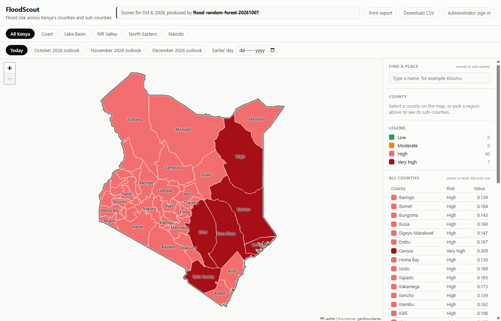

# FloodScout

**FloodScout is a geospatial flood risk scoring engine for Kenya (U-CS 10).
The dashboard and alerts are reference clients.**

The engine scores the flood risk of each of Kenya's 47 counties, 290
sub-counties and 768 grid cells every day, and serves the scores through a
REST API. The scores come from a model trained on 26 years of recorded
floods, rainfall, climate indices and terrain. Beside *when* a flood is
likely (hazard), the engine now says *where* inside a county the water goes
(susceptibility), from a second model trained on satellite flood maps.
*Who is there* (exposure) is not built yet. `docs/ENGINE_SPEC.md` says what
it computes, what it does not, and what is still to be built.

The interactive map and the alert service show that the scores are usable.
Other capstones own alerting (U-CS 13) and the dashboard (U-CS 17);
FloodScout's are reference clients (`docs/ARCHITECTURE.md`).

Live at https://floodscout.me, with the API at https://api.floodscout.me.

Final year capstone project by Murega Kelvin Mutwiri, School of Computing
and Engineering Sciences, Strathmore University. Supervised by
Dr. Deperias Kerre.



## Contents

- [What it does](#what-it-does)
- [How it is built](#how-it-is-built)
- [Getting started](#getting-started)
- [Loading the data](#loading-the-data)
- [The dashboard](#the-dashboard)
- [The model](#the-model)
- [Tests and checks](#tests-and-checks)
- [Project layout](#project-layout)
- [Status](#status)
- [Documentation](#documentation)
- [Licence and access](#licence-and-access)

## What it does

### The engine

- **Scores every region daily.** Each county and sub-county gets a risk
  category (Low, Moderate, High or Very High) from the last 30 days of
  rainfall, the El Niño and Indian Ocean Dipole indices, the time of year
  and the terrain. A scheduler refreshes the scores once a day. A window
  with little rain (under 25 mm, or under half the county's normal) is
  shown no higher than Moderate, whatever the season says
  (`riskengine/dry.py`).
- **Trained nationally, presented for the flood-prone regions.** The
  dashboard opens on five focus regions (23 counties: the Coast, the Lake
  Victoria Basin, the Rift Valley, the northern rivers and Nairobi metro,
  each cited in `geodata/focus_regions.py`), with All Kenya one click away.
  The model is still trained on all 47 counties. The flood archive is
  national, and training on 23 counties would halve the rows it learns
  from. In the model README's learning curve, half the rows scored an
  average precision of 0.255 against 0.297 for all of them.
- **Looks back and ahead.** It keeps the scores of earlier days, forecasts
  every region for each of the next seven days from forecast rain, and
  gives a seasonal outlook for the next three months.
- **Says where the water goes.** A susceptibility model scores every 250 m
  of Kenya for how likely it is to flood, from height above the nearest
  drainage (HAND), wetness, upstream area, slope and distance to a river.
  The engine sums it up per county and sub-county: the share of land
  expected under water, the share among Kenya's most flood-prone fifth, and
  a rank (`riskengine/susceptibility.py`, served at
  `GET /api/regions/<id>/susceptibility/`). It is context only; it does not
  change the hazard colours or the alerts.
- **Explains each score.** Each prediction is split exactly into what each
  group of inputs added or took away, in times the usual chance. Checked
  against SHAP on the 2,679 final-test rows: the same leading group of
  inputs 86.7% of the time, median rank correlation 0.96
  (`manage.py shap_check`, `riskengine/ml/artifacts/shap_check.json`).
- **Reads the official warnings.** The Kenya Meteorological Department's
  CAP feed is read every hour (`fetch_kmd_warnings`). Each warning is
  matched to the counties it covers, shown on the map and named in any
  FloodScout alert for the same place. It never changes an alert's level.
- **Reports its own accuracy.** `riskengine/ml/artifacts/metrics.json`
  records how the model did on years it was not trained on, including where
  it is weak, and `GET /api/admin/analytics/` serves it to administrators
  and analysts, with a live record of the model against flood reports from
  ReliefWeb (`fetch_flood_reports`; off until `RELIEFWEB_APPNAME` is set).

### Reference clients

- **Shows the scores on a map.** Anyone can open the dashboard without an
  account, search for a place by name, and select a region to see its score.
  The colour shows, by default, the risk against an ordinary year for the
  same place and month (`riskengine/season.py`), so a wet season does not
  paint every county the same: on 27 October 2026 it ran from 0.6 (Kericho,
  a third of its normal rain) to 2.2 (Garissa, more than twice its normal).
  It can also show the risk level, the risk as a multiple of the usual
  chance, its change over a week or the rain against normal, over a choice
  of basemaps (map, satellite, today's satellite image, terrain).
- **Puts the risk in context.** Rivers, the 100-year flood zone, 84 large
  floods recorded in Kenya since 1988 and NASA's satellite rainfall can be
  drawn over the risk, and a selected place lists the floods recorded there
  before.
- **Looks back and ahead.** The dashboard draws a 30-day history chart, the
  forecast and the outlook. A timeline with a Play button moves the map from
  30 days ago through to the end of the forecast.
- **Says what is going on.** A situation briefing, written from the data,
  says how many places are at each level, where risk is rising, what the
  forecast brings and whether the risk comes from rain or from the season
  and the oceans. Places that need watching are listed and pulse on the map.
- **Warns people.** Every morning fixed rules read the scores and the
  forecast and issue, raise or end a flood advisory, watch or warning for
  each county and sub-county. Anyone can ask for alerts for up to ten places
  by email, confirmed with a code. Every alert is
  also published as a Common Alerting Protocol (CAP 1.2) feed that other
  warning systems can read. A banner and badges on the map show what is in
  force, and an administrator can issue or cancel alerts by hand, or stop
  a person's alerts at their request.
- **Warns about saved places.** A signed-in person can save up to five
  places (a school, a farm), found by address or by a long press on the
  map, and gets warnings for each by name.
- **Works offline.** The dashboard installs as an app on a phone or
  computer. Without a network it opens with the last map it loaded and says
  how old it is (`frontend/public/sw.js`).
- **Shows KMD's warnings.** The Kenya Meteorological Department's warnings
  in force are a map layer and a notice on each region they cover, in both
  the detailed and the simple view.
- **Explains each score.** "Why this score" draws the engine's explanation,
  with a sentence saying what drove it. The inputs themselves are listed
  too, each against its usual value. "Where the water goes" shows the
  region's susceptibility beside it.
- **Reports its own accuracy.** The model and system analytics page shows
  the evaluation, where the model fails, the live record, forecast skill,
  agreement with KMD, the alerts sent and the health of the data feeds.
- **Exports.** The view on screen can be printed as a report or downloaded
  as a CSV file.
- **Lets an administrator rescore.** A System Administrator can sign in and
  score every region again, from the dashboard or the Django admin site.
- **Has proper sign-in.** Sign-in and sign-up pages, password reset by email,
  and sign-in with Google, Microsoft or GitHub (OAuth 2.0 and OpenID Connect).
- **Has accounts and profiles.** Anyone can create an End User account. The
  profile page (`#/profile`) holds a person's details, password, alert
  subscriptions and recent activity. A System Administrator also manages the
  users (role, on or off) and reads the activity log of sign-ins, rescores,
  alerts issued and cancelled, and account changes.

## How it is built

Three tiers, as designed in Chapter 4 of the project proposal:

| Tier | Technology | Where |
|---|---|---|
| Data | PostgreSQL 16 with PostGIS 3.4 | `geodata/`, `riskengine/models.py` |
| Application | Django 5.2 and Django REST Framework, with the risk engine inside it: a scikit-learn Random Forest, trained offline on Google Colab and loaded from `riskengine/ml/artifacts/` | `riskengine/`, `api/`, `geodata/`, `accounts/`, `alerts/` |
| Client | Leaflet.js, built with Vite | `frontend/` |

Training is not a tier: it runs on Colab from `notebooks/`, and only the
model file and its metrics come back into the repo. `docs/ARCHITECTURE.md`
shows which modules are the engine and which are reference clients.

The whole stack runs in Docker. GitHub Actions runs the lint, both test
suites and the dashboard build on every pull request.

## Getting started

### Prerequisites

- Docker Desktop with the WSL2 backend (recommended), **or** Python 3.12,
  PostgreSQL 16 and PostGIS 3.4 installed natively
- Node.js, for the dashboard in `frontend/`
- Optional: a Google Earth Engine account, only for building a training set
  on county-mean rainfall (see [Earth Engine](#earth-engine-optional))

### With Docker (recommended)

```bash
cp .env.example .env          # then edit DJANGO_SECRET_KEY at minimum
docker compose up --build
```

This starts PostGIS, the Django development server and the daily refresh.
On the first run, in another terminal:

```bash
docker compose exec web python manage.py migrate
docker compose exec web python manage.py createsuperuser
```

Then check:

- http://localhost:8000/api/health/ returns `{"status": "ok", ...}`
- http://localhost:8000/admin/ opens the Django admin; sign in with the
  superuser

The superuser is also a System Administrator on the dashboard. To make an
ordinary account an administrator, set its **Role** in the Django admin
(Users).

### If port 8000 is already taken

This is common on Windows, where a vendor service often owns port 8000.
Docker cannot bind the port, so the `web` container stays in `created` and
nothing listens, with no obvious error. Set `WEB_PORT` in `.env` to a free
port:

```bash
echo "WEB_PORT=8010" >> .env
docker compose up -d
docker compose ps            # web should read 0.0.0.0:8010->8000/tcp, running
```

The container always listens on 8000 internally; only the host port moves,
so every URL above becomes `http://localhost:<WEB_PORT>/...`. Point
`VITE_API_BASE_URL` in `frontend/.env.local` at the same port.

### Without Docker

Only do this if PostgreSQL, PostGIS and the GDAL, GEOS and PROJ system
libraries are already installed. This is fiddly on native Windows; WSL2 is
much easier.

```bash
python -m venv .venv
.venv\Scripts\activate        # Windows
# source .venv/bin/activate   # WSL2, Linux or macOS
pip install -r requirements.txt
cp .env.example .env          # set DB_HOST=localhost, edit DJANGO_SECRET_KEY
python manage.py migrate
python manage.py createsuperuser
python manage.py runserver
```

## Loading the data

These commands fill an empty database with real data and score it. Run them
in order; each is safe to run again.

```bash
docker compose up -d
docker compose run --rm web python manage.py migrate
docker compose run --rm web python manage.py seed_regions                      # 47 county boundaries
docker compose run --rm web python manage.py seed_regions --level sub_county   # 290 sub-counties
docker compose run --rm web python manage.py seed_terrain                      # elevation and slope
docker compose run --rm web python manage.py seed_rainfall                     # daily rainfall, last 61 days
docker compose run --rm web python manage.py score_regions                     # one score per region for today
docker compose run --rm web python manage.py flood_outlook                     # county outlook, next three months
docker compose run --rm web python manage.py flood_outlook --level sub_county
docker compose run --rm web python manage.py seed_flood_events                 # past floods, for the map
docker compose run --rm web python manage.py build_map_layers                  # rivers and flood zone, see below
docker compose run --rm web python manage.py fetch_kmd_warnings                # KMD's warnings in force
```

The susceptibility summary per region is committed with its model run
(`riskengine/ml/artifacts/susceptibility/<run>/regions.json`), so the server
needs neither the 250 m pixels nor Earth Engine. `build_susceptibility`
rebuilds it from a new run.

`build_map_layers` writes the rivers and the 100-year flood zone into
`frontend/public/layers/`, which is committed, so it only needs running to
refresh them. It reads the downloads `seed_drainage` makes and fetches them
if they are missing (about 300 MB).

`seed_terrain` and `seed_rainfall` need network access. Everything after
them works offline, because the values are in the database.

While the stack is up, the `scheduler` service keeps the map current. It
runs `refresh_scores` (`seed_rainfall`, then `score_regions`) when it starts
and once a day after that. Each run also scores any days since the last
scored one, up to a month back, so days the computer was off still appear on
the map. To refresh by hand:

```bash
docker compose run --rm web python manage.py refresh_scores
```

Each refresh also issues the 7-day forecast (`forecast_scores`), reads
KMD's warnings and the ReliefWeb flood reports, and then brings the alerts
up to date and sends them (`issue_alerts`). KMD's feed is read again every
hour in between, and each run starts on a fresh database connection, so a
connection the database dropped overnight does not stop it. The forecast is the same
model run on the rain that has fallen joined to the rain forecast for the
days between. The forecast rain is never stored as rainfall; only the
forecast scores are, in `RiskForecast`, and earlier issues are kept so a
forecast can be checked against what the day actually scored.

On Windows, Docker Desktop does not start on its own unless told to, and the
scheduler runs only while it does. To have the scores refresh without
opening anything, register the scheduled task once:

```powershell
powershell -ExecutionPolicy Bypass -File scripts\windows\install-scheduler-task.ps1
```

It starts Docker and the scheduler when you sign in and every morning at
07:00, or as soon as the computer is on if it was off at 07:00. It writes to
`scheduler-task.log`. Remove it with
`Unregister-ScheduledTask -TaskName "FloodScout daily refresh" -Confirm:$false`.

The seasonal outlook is not part of the daily refresh. Run `flood_outlook`
when a new monthly forecast is out.

### Risk by area

A county score gives the whole county one colour, even when the rain fell
on one side of it. The area grid splits Kenya into squares of 0.25 degrees
(about 28 km, 768 squares) and scores each from the rain measured at its
centre, with its own elevation and slope. The dashboard's "Colour by: Area"
switch draws it.

```bash
docker compose run --rm web python manage.py seed_grid    # once: lay the grid, measure terrain
docker compose run --rm web python manage.py score_grid   # today; refresh_scores does this daily
```

The model learned from floods recorded per county, so a square's score is
the chance of a large flood for a county that had received that square's
rain. It shows where the dangerous rain fell, not the outline of a flood.
`seed_grid --cell-deg 0.1` gives finer squares, but about 4,700 of them,
which is more daily rainfall requests than Open-Meteo's free tier allows.

### Alerts

`issue_alerts` applies the rules in `alerts/rules.py` to the newest scores
and forecast:

| Level | When |
|---|---|
| Warning | Very High and rising with heavy rain for the county in the 7-day forecast, or forecast Very High within 3 days with heavy rain for the county in those days |
| Watch | Very High today, or forecast Very High within 7 days |
| Advisory | High and rising, or a day of 50 mm or more in the forecast |

"Heavy rain for the county" is forecast rain above the county's own line
for a week in that month (the 90th percentile of its wettest weeks, 1996
to 2016) and at least 30 mm, or a day of 50 mm. 50 mm in a day is the Kenya
Meteorological Department's flood early-warning proxy. High on its own
never alerts. Where a KMD warning is in force, the alert names it among its
reasons, without changing the level.

Replayed over 1996 to 2016 with the rain that actually fell (a perfect
forecast, so better than live):

| Rule | Alerts | Floods caught | Followed by a flood |
|---|---|---|---|
| Very High alone (Watch) | 2,177 | 584 of 1,225 | 26.8% |
| Warning | 449 | 141 of 1,225 | 31.4% |

On 2017 to 2021, scored once afterwards, the Warning rule gave 260 alerts,
caught 66 of 181 floods, and 25.4% were followed by a flood
(`manage.py backtest_alerts`).

An alert is raised rather than duplicated when its conditions worsen, and
steps down without a message when they ease, so the map shows what the
rules say today. It ends when they give nothing.

**Warnings for where you live.** A new account is asked for the code that
confirms its email straight after sign-up (and at sign-in while it is still
unconfirmed); a Google sign-in needs none. On the profile, the person says
where they live, by searching an address (OpenStreetMap's free Nominatim
geocoder, called by the API, limited to Kenya and to one request a second),
by sharing their device's location, or by choosing their sub-county. The
point is kept to about 100 m. From then on every alert for that sub-county or
its county reaches them by itself, marked "Where you live", with no alerts
page or form (`accounts/home.py`). They choose the level, and can turn it off.
Saved places work the same way (`accounts/places.py`), and their emails
name the place: "School: Flood watch for Nyando (Kisumu County)".

Signed in, "Get flood alerts" on a place, an alert or the alerts page uses
the email on the person's profile, with no form. If it is verified (by
Google, or by a code once) it starts at once and sends any alert already in
force; otherwise a six-digit code is asked for the first time only. Changing
the email on the profile asks for a code again.

Email is sent through SMTP when `EMAIL_HOST` is set in `.env` (Gmail works
with an app password) and is otherwise written to `data/outbox/`. Alerts go
by email only. SMS (Africa's Talking) is used just to confirm the phone
number on a profile: put a sandbox key in `AT_API_KEY` and leave
`AT_USERNAME=sandbox`, and the codes appear in the Africa's Talking
simulator. Set `PUBLIC_API_URL` and `DASHBOARD_URL` to where the API and the
dashboard are reached, for sign-in redirects. Links inside emails come from
`EMAIL_API_URL` and `EMAIL_DASHBOARD_URL`, which default to the deployed
site, so mail sent from a development machine never carries localhost links.

The feeds are open: `GET /api/alerts/` (JSON), `GET /api/alerts/feed/` (Atom)
and `GET /api/alerts/<id>/cap/` (CAP 1.2). Their CAP status is `Exercise`
(`CAP_STATUS`), because FloodScout is not a warning authority.

### Signing in

`#/signin` and `#/signup` are full pages. People sign in with a username or
email and password, or with Google, Microsoft or GitHub; a forgotten
password is reset by an emailed link (`#/forgot`). "Keep me signed in"
starts ticked, so the sign-in is kept on the device and a link opened from
an email finds the person signed in; untick it on a shared computer to keep
the sign-in to one tab.

Social sign-in uses the authorization-code flow with PKCE, and OpenID Connect
for Google and Microsoft (`accounts/social.py` explains each step). An
existing account is joined by email only when the provider vouches for the
address (Google, GitHub); a Microsoft sign-in with an email already in use
is refused, because Microsoft does not verify that claim for every account.
A provider's button appears only once its keys are in `.env`. Set up Google
first: almost everyone has a Google account, and Google vouches for the
email, so a person who signs in with Google gets alerts in one click with no
code. Microsoft and GitHub are optional.

| Provider | Where to get the keys | Redirect URI to register |
|---|---|---|
| Google | Google Cloud console, APIs and Services, Credentials, OAuth client ID, type "Web application" | `<PUBLIC_API_URL>/auth/social/google/callback/` |
| Microsoft | Microsoft Entra admin centre, App registrations, "Accounts in any organizational directory and personal Microsoft accounts", platform "Web" | `<PUBLIC_API_URL>/auth/social/microsoft/callback/` |
| GitHub | GitHub, Settings, Developer settings, OAuth Apps | `<PUBLIC_API_URL>/auth/social/github/callback/` |

Set `GOOGLE_CLIENT_ID` and `GOOGLE_CLIENT_SECRET` (and the `MICROSOFT_` and
`GITHUB_` pairs) in `.env`, and restart the web container. With
`PUBLIC_API_URL=http://127.0.0.1:8010/api`, Google's redirect URI is
`http://127.0.0.1:8010/api/auth/social/google/callback/`.

### Where the data comes from

All of it is real and public. Nothing is simulated, and a value that could
not be measured is left empty.

| Data | Source |
|---|---|
| County and sub-county boundaries | geoBoundaries (KEN ADM1 and ADM2), pinned to a commit |
| Elevation and slope | Open-Meteo elevation API (Copernicus DEM GLO-90) |
| Daily rainfall | ECMWF, served by Open-Meteo |
| El Niño index (ONI) | NOAA Climate Prediction Center |
| Indian Ocean Dipole index (DMI) | NOAA Physical Sciences Laboratory |
| Recorded floods, for training | Dartmouth Flood Observatory, 1996 to 2021 |
| Satellite flood extents, for checking only | UNOSAT, November 2023 and April 2024 |
| Susceptibility inputs and training floods | MERIT Hydro, JRC Global Surface Water, Copernicus GloFAS flood hazard, Global Flood Database (via Earth Engine) |
| Official warnings | Kenya Meteorological Department CAP feed |
| Flood reports, for the live record | ReliefWeb API |
| Rivers and the 100-year flood zone, for the map | OpenStreetMap; Copernicus GloFAS |
| Basemaps and satellite layers, for the map | Esri, OpenTopoMap, NASA GIBS (VIIRS, GPM IMERG) |

`docs/DATA_DICTIONARY.md` documents each source, its fields and its licence.
The `data/` folder is not committed; `build_training_set` downloads and
rebuilds it.

## The dashboard

The Leaflet map is a standalone Vite app in `frontend/`, served on
http://localhost:5173 in development. With the API running and the database
loaded:

```bash
cd frontend
npm install
npm run dev
```

`frontend/README.md` covers the API address and why the client is a separate
app and not a Django template.

## The model

A Random Forest that gives the chance of a large flood being recorded in a
region in a 30-day window. It was trained on Google Colab from
`notebooks/train_flood_model.ipynb`, on 14,523 county-months from 1996 to
2021.

It was compared with Logistic Regression and Gradient Boosting, and with two
baselines, by cross-validation that holds out whole years:

| Measure | Result |
|---|---|
| ROC AUC | 0.787 |
| Average precision | 0.254, against 0.097 for always giving the usual chance |
| Against a model that knows only the month | 2.05 times its average precision |
| Floods caught by a warning (High and above) | 71.7% |
| Warnings followed by a recorded flood | 21.5% |

**Read this as modest skill.** The model orders regions by risk better than
the season alone does, but it is not a precise forecast. On the 2017 to 2021
final test it was only 1.08 times the season-only model, and against
satellite flood maps it ranked one of two floods well and the other badly.
The main limit is the flood records, which place each flood as a circle and
not as an outline.

`riskengine/ml/README.md` has the full evaluation, the known limits and a log
of every experiment. Read it before presenting a result. Every score and API
response carries the `model_version` that produced it, and the dashboard's
model performance panel shows these figures from `GET /api/admin/analytics/`.

Models are trained from a config file, which fixes the training set, the
candidates and the decision rule before the run. Each run writes its own
folder (model, metrics, config, summary) and a line for the experiments
ledger:

```bash
docker compose run --rm web python -m riskengine.ml.pipeline train --model hazard --config riskengine/ml/configs/hazard_rf_20261007.toml --check
```

### The susceptibility model

Gradient boosting on 117,350 pixels of 25 mapped Kenyan floods (Global
Flood Database), trained on Colab under a protocol committed before
training (`riskengine/ml/SUSCEPTIBILITY_PROTOCOL.md`). It ranks pixels
within a county at 0.792 ROC AUC with whole floods held out, against 0.718
for HAND alone.

It was then scored once, and only once, against the UNOSAT satellite maps
of November 2023 and April 2024:

| Scored by | Sub-counties within a county | 250 m pixels |
|---|---|---|
| **Susceptibility model** | **0.915** | 0.740 |
| HAND | 0.856 | 0.753 |
| Sub-county area alone | 0.838 | |
| The hazard engine | 0.461 | |

It ranks which sub-counties flood far better than the hazard engine does,
but on single pixels it does not beat HAND. That test is now closed. The run
and its result are in
`riskengine/ml/artifacts/susceptibility/20261102T1246Z_77a8329/`.

### Earth Engine (optional)

Earth Engine is used to build the susceptibility sample and pixels, and by
`build_training_set --rain-source earth-engine` to average rainfall over
each county. Scoring and the default training set use Open-Meteo and need
no account. To use it, set `EE_PROJECT_ID` in `.env` and authenticate
once per machine:

```bash
docker compose run --rm web earthengine authenticate --auth_mode=notebook
```

## Tests and checks

```bash
docker compose run --rm web python manage.py test   # Django tests
ruff check .                                        # lint; rules are in ruff.toml
cd frontend && npm test                             # dashboard tests
```

GitHub Actions runs all three, and builds the dashboard, on every pull
request into `develop` and `main` (`.github/workflows/ci.yml`). It uses the
same `docker-compose.yml`, so CI tests what runs locally. `api/tests.py`
checks that reading is open to everyone and rescoring is for an
administrator only.

Analysis-only packages (SHAP, matplotlib) are in
`requirements-analysis.txt`, not in the app image.

## Project layout

```
FloodScout/
├── floodscout/     Django project config (settings, root urls, wsgi/asgi)
├── accounts/       Custom User model (System Administrator, Analyst and
│                   End User roles), sign-in, social sign-in, home and
│                   saved places
├── geodata/        Region, GeospatialFeature and EnvironmentalData models,
│                   the seed_* commands and the data-source clients (KMD)
├── riskengine/     RiskScore and RiskOutlook models, scoring and the
│                   scoring commands, plus riskengine/ml/ for the training
│                   pipeline, the hazard and susceptibility models, their
│                   metrics and the experiments ledger
├── alerts/         Alert rules, subscriptions, email and the CAP feed
├── api/            REST endpoints tying the above together
├── frontend/       Leaflet dashboard, a standalone Vite app
├── notebooks/      The Colab training runs with their evaluation charts
├── scripts/        The Windows scheduled task and the app icon drawer
├── deploy/         The Caddy reverse proxy configuration for the VM
├── data/           raw/, processed/ and external/; not committed
└── docs/           The engine spec, the architecture, the data dictionary,
                    the deployment guide and the figures
```

The four Django apps map onto the Class Diagram and ERD in Chapter 4
(Sections 4.3.4 and 4.4.1), so a model here traces back to an entity there.
The docstring on each model says which.

## Status

As of 11 November 2026.

**The engine**

| Area | State |
|---|---|
| Hazard model | Done. Random Forest trained on Colab, cross-validated by year, tested once on 2017 to 2021 (that test is now closed), checked against satellite extents. Its explanations are checked against SHAP. |
| Daily scoring | Done. Counties, sub-counties and a 768-cell grid (0.25°), with the 7-day forecast and the seasonal outlook. Missed days are caught up. |
| Data pipeline | Done. 47 counties and 290 sub-counties with real terrain, rainfall and drainage; KMD's warnings read hourly. |
| Training pipeline | Done. Config-driven runs, each with its own folder and a ledger line; the susceptibility sample is a pinned snapshot. |
| Susceptibility model | Done. Trained under a pre-registered protocol, shipped, summed per county and sub-county, and scored once against UNOSAT (0.915 for sub-counties). |
| Live record | Built; waiting on ReliefWeb to approve the app name. |
| Exposure and the combined risk index | Not started. |
| Versioned API (`/api/v1/`, OpenAPI schema, API keys) | Not started. |
| Likely flood type per place | Protocol drafted (`riskengine/ml/FLOOD_TYPE_PROTOCOL.md`); nothing computed. |
| Deployment | Done 28 October 2026. API at `https://api.floodscout.me`, dashboard at `https://floodscout.me`. |
| Checks | Done. Lint, Django tests and dashboard tests and build run on every pull request. |

**Reference clients**

| Area | State |
|---|---|
| Dashboard | Done: map, simple view, map layers (with KMD's warnings), history, timeline, explanation, susceptibility, briefing, themes, phone layout and menu, offline app, report and CSV export. |
| Alerts | Done: rules, email with double opt-in, the CAP 1.2 feed, where-you-live and saved-place alerts, the administrator's controls. |
| Accounts | Done: sign-in and sign-up pages, Google, Microsoft and GitHub sign-in, profiles, saved places, the Analyst role, the activity log. |
| Analytics | Done: evaluation, where it fails, live record, forecast skill, agreement with KMD, alerts, satellite check and system health. |

**Still open:** performance testing on the deployed API, user testing, and
the report.

## Documentation

| Document | What it holds |
|---|---|
| `docs/ENGINE_SPEC.md` | What the engine computes: components, inputs, outputs, spatial units, cadence, limits and scope |
| `docs/ARCHITECTURE.md` | The tiers, the engine and its reference clients |
| `docs/DEPLOYMENT.md` | How the API and the dashboard are deployed |
| `docs/FUTURE_WORK.md` | What is out of scope, kept instead of built |
| `riskengine/ml/README.md` | The model: inputs, evaluation, limits and the experiments log |
| `riskengine/ml/SUSCEPTIBILITY_PROTOCOL.md` | The susceptibility model's rules, fixed before training |
| `riskengine/ml/experiments.md` | The ledger of every training run and test |
| `docs/DATA_DICTIONARY.md` | Every data source, its fields and its licence |
| `docs/figures/` | The evaluation charts and the dashboard screenshots |
| `frontend/README.md` | The dashboard: configuration and design choices |

## Licence and access

Copyright © 2026 Murega Kelvin Mutwiri. All rights reserved.

The code is shared with the project supervisor and the examiners of
Strathmore University for assessment of the capstone project. No licence is
granted to copy, modify or redistribute the code, the trained model or the
documents; see [`LICENSE`](LICENSE).

For permission or enquiries: kevomurega@gmail.com. The live system is at
https://floodscout.me.

The datasets the system reads belong to their publishers and keep their own
licences, which are listed with each source in `docs/DATA_DICTIONARY.md`.
